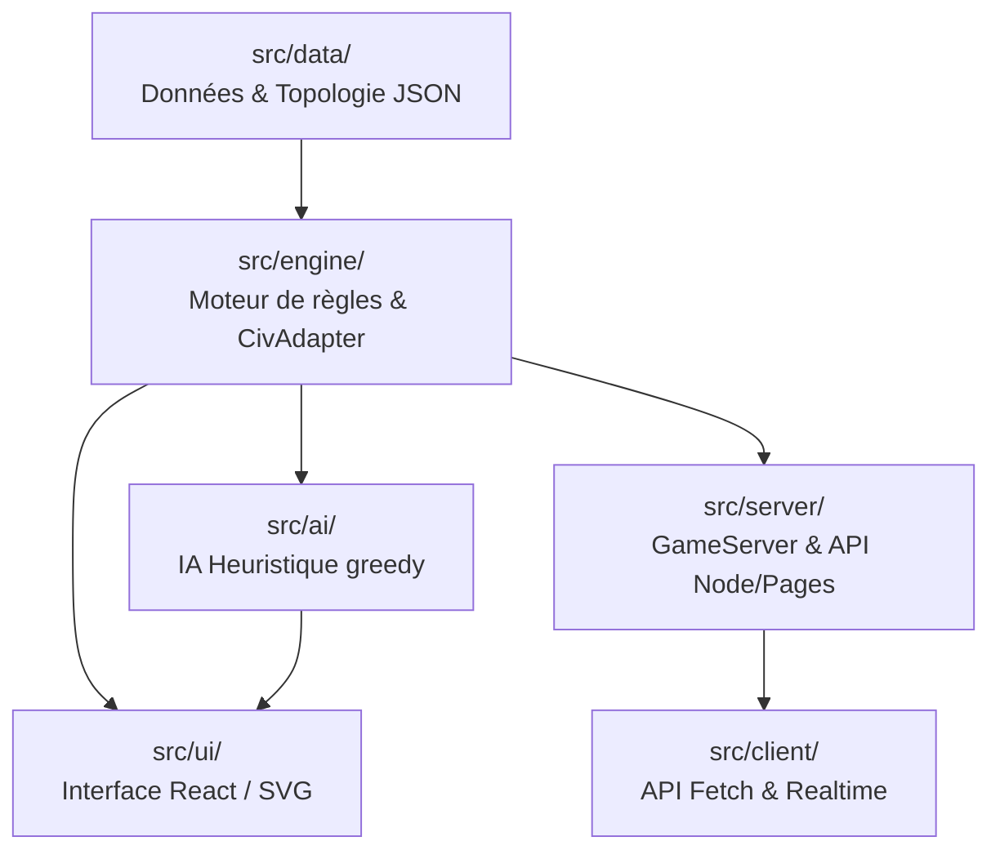

# Panorama Général du Code et Possibilités d'Amélioration de l'Interface

Ce document dresse un état des lieux complet de l'architecture logicielle d'**Advanced Civilization** (portage numérique du jeu de plateau Avalon Hill de 1991), détaille le fonctionnement de chaque brique technique et propose une feuille de route concrète pour moderniser et enrichir l'interface utilisateur.

---

## Sommaire

1. [Vue d'ensemble et Philosophie d'Ingénierie](#1-vue-densemble-et-philosophie-dingénierie)
2. [Cartographie de l'Architecture Technique](#2-cartographie-de-larchitecture-technique)
   - [Le Moteur de Règles (`src/engine/`)](#21-le-moteur-de-règles-srcengine)
   - [Les Données du Jeu et Topologie (`src/data/`)](#22-les-données-du-jeu-et-topologie-srcdata)
   - [L'Intelligence Artificielle Heuristique (`src/ai/`)](#23-lintelligence-artificielle-heuristique-srcai)
   - [L'Interface Utilisateur Actuelle (`src/ui/`)](#24-linterface-utilisateur-actuelle-srcui)
   - [Serveur, Client API et Multijoueur (`src/server/`, `src/client/`)](#25-serveur-client-api-et-multijoueur)
3. [Cycle d'un Tour de Jeu : Les 12 Phases](#3-cycle-dun-tour-de-jeu-les-12-phases)
4. [Diagnostic Critique de l'Interface Actuelle](#4-diagnostic-critique-de-linterface-actuelle)
   - [Forces de l'Implémentation Actuelle](#41-forces-de-limplémentation-actuelle)
   - [Faiblesses Ergonomiques, Techniques et Visuelles](#42-faiblesses-ergonomiques-techniques-et-visuelles)
5. [Axes d'Amélioration de l'Interface Utilisateur (UI/UX)](#5-axes-damélioration-de-linterface-utilisateur-uiux)
   - [Axe 1 : Architecture UI & Découpage Modulaire](#axe-1--architecture-ui--découpage-modulaire)
   - [Axe 2 : Identité Visuelle et Design System "Antique Moderne"](#axe-2--identité-visuelle-et-design-system-antique-moderne)
   - [Axe 3 : Navigation Cartographique Interactive (Pan & Zoom)](#axe-3--navigation-cartographique-interactive-pan--zoom)
   - [Axe 4 : Ergonomie des Phases Complexes (Commerce, Avances, AST)](#axe-4--ergonomie-des-phases-complexes-commerce-avances-ast)
   - [Axe 5 : Mode Hotseat Local et Confidentialité (Écrans de Transition)](#axe-5--mode-hotseat-local-et-confidentialité-écrans-de-transition)
   - [Axe 6 : Internationalisation et Localisation Française](#axe-6--internationalisation-et-localisation-française)
6. [Feuille de Route Suggérée (Par Étapes)](#6-feuille-de-route-suggérée-par-étapes)

---

## 1. Vue d'ensemble et Philosophie d'Ingénierie

Le projet est un portage numérique sur le web du mythique jeu de plateau **Advanced Civilization** (1991), fondé sur le framework [`digital-boardgame-framework`](https://www.npmjs.com/package/digital-boardgame-framework).

L'architecture actuelle repose sur plusieurs principes directeurs très rigoureux :
- **Moteur déterministe pur (State-Driven)** : L'état du jeu (`GameState`) est un objet JavaScript entièrement sérialisable (aucun état caché dans des closures ou des instances de classes). Les transitions d'état sont pures, reproductibles grâce à un générateur pseudo-aléatoire à graine (`Rng`).
- **Conservation absolue des pièces** : Tout est conservé (les 55 pions par nation, 9 cités, 4 navires, 126 cartes de commerce et calamités). Rien n'est détruit, les éléments circulent entre le stock, le plateau, la trésorerie et la défausse.
- **Approche Engine-First** : La priorité absolue a été donnée à l'exactitude des règles officielles (les 12 phases, la gestion des surplus, les calamités complexes comme la Guerre Civile ou la Piraterie, les bandes AST authentiques extraites du module VASSAL).
- **Indépendance graphique légale** : L'application génère sa propre géométrie vectorielle (SVG) pour le plateau de jeu et n'embarque pas les illustrations sous copyright. Les joueurs possédant le module VASSAL peuvent néanmoins charger les visuels originaux en local via IndexedDB (`mapArt.ts`).

---

## 2. Cartographie de l'Architecture Technique



### 2.1. Le Moteur de Règles (`src/engine/`)

Le moteur implémente le contrat `GameAdapter<GameState, Action, PlayerId>` fourni par le framework.

- **[types.ts](file:///c:/Users/alano/OneDrive/Documents/GitHub/advanced-civilization/src/engine/types.ts)** : Définit toutes les structures de données fondamentales :
  - `GameState` : contient le tour, la phase courante, l'ordre d'action (`activeOrder`), les joueurs (`PlayerState`), la carte (`AreaState` pour 222 zones), l'état des piles de commerce, l'AST, les offres d'échange en cours, l'historique (`log`).
  - `Action` : union discriminée de toutes les actions permises (`placeStart`, `placeTokens`, `moveUnits`, `buildShip`, `buildCity`, `buyAdvance`, `proposeTrade`, `acceptTrade`, `chooseCities`, etc.).
- **[engine.ts](file:///c:/Users/alano/OneDrive/Documents/GitHub/advanced-civilization/src/engine/engine.ts)** (~190 Ko) : Implémentation complète de la machine à états :
  - `legalActions(state, actor)` : calcule strictement les actions légales de l'acteur courant selon la phase et le contexte.
  - `applyAction(state, action, actor)` / `tryApplyAction` : applique l'action et retourne le nouvel état ou l'erreur justifiée.
  - `normalize(state)` : avance automatiquement les phases système et les sous-étapes jusqu'à atteindre un joueur devant prendre une décision interactive (`currentActor(state)`).
  - Gestion des sous-systèmes critiques : combat (§24), pillage, attrition, élimination des surplus (§26), soutien des cités, résolution en cascade des calamités (§29-30).
- **[helpers.ts](file:///c:/Users/alano/OneDrive/Documents/GitHub/advanced-civilization/src/engine/helpers.ts)** : Fonctions pures de calcul : crédits technologiques pour l'achat d'avances, calcul de la valeur des séries de marchandises ($n^2 \times \text{valeur}$), voisinage terrestre et maritime, calculs de soutien.
- **[boards.ts](file:///c:/Users/alano/OneDrive/Documents/GitHub/advanced-civilization/src/engine/boards.ts)** & **[setup.ts](file:///c:/Users/alano/OneDrive/Documents/GitHub/advanced-civilization/src/engine/setup.ts)** : Préréglages de cartes selon le nombre de joueurs (2 à 8 joueurs) et initialisation d'une partie avec sélection des zones de départ.

### 2.2. Les Données du Jeu et Topologie (`src/data/`)

Toutes les données statiques du jeu proviennent de l'extraction automatisée des règles et du module VASSAL :
- **[areas.json](file:///c:/Users/alano/OneDrive/Documents/GitHub/advanced-civilization/src/data/areas.json)** & **[adjacency.json](file:///c:/Users/alano/OneDrive/Documents/GitHub/advanced-civilization/src/data/adjacency.json)** : 222 zones terrestres et maritimes avec limites de population, emplacements de cités (`citySite`), plaines inondables (`floodplain`), sites volcaniques.
- **[territories.json](file:///c:/Users/alano/OneDrive/Documents/GitHub/advanced-civilization/src/data/territories.json)** & **[coastlines.json](file:///c:/Users/alano/OneDrive/Documents/GitHub/advanced-civilization/src/data/coastlines.json)** : Coordonnées polygonales précises de chaque région pour le rendu vectoriel SVG.
- **[advances.json](file:///c:/Users/alano/OneDrive/Documents/GitHub/advanced-civilization/src/data/advances.json)** : Les 24 cartes d'avances (Arts, Métiers, Sciences, Civisme, Religion), leurs coûts de base, leurs effets en jeu et leurs réductions croisées.
- **[ast.json](file:///c:/Users/alano/OneDrive/Documents/GitHub/advanced-civilization/src/data/ast.json)** : Piste A.S.T. (Archaeological Succession Table) spécifique à chacune des 14 civilisations (ex: Égypte démarre l'âge du Bronze plus tôt que la Thrace).
- **[calamities.json](file:///c:/Users/alano/OneDrive/Documents/GitHub/advanced-civilization/src/data/calamities.json)** & **[commodities.json](file:///c:/Users/alano/OneDrive/Documents/GitHub/advanced-civilization/src/data/commodities.json)** : 12 calamités (4 non négociables, 8 négociables) et 18 marchandises réparties en 9 piles de commerce.

### 2.3. L'Intelligence Artificielle Heuristique (`src/ai/heuristic.ts`)

L'IA implémente `PlayerController` :
- **Principe d'équité ("Multiplayer-fair")** : L'IA ne triche jamais et ne regarde pas dans la main adverse. Elle planifie ses propositions d'échange à l'aveugle.
- **Comportement par phase** :
  - *Mouvement* : optimise le transport maritime, concentre 6 pions sur les sites de cités stratégiques, disperse le surplus pour éviter l'attrition.
  - *Cités* : construit systématiquement si les cités peuvent être soutenues par la population restante.
  - *Commerce* : recherche les échanges augmentant ses séries de cartes, tente d'évacuer discrètement les calamités négociables parmi les cartes non déclarées.
  - *Avances* : achète par paniers optimisés en maximisant le ratio valeur/coût et en diversifiant les groupes de cartes.

### 2.4. L'Interface Utilisateur Actuelle (`src/ui/`)

- **[main.tsx](file:///c:/Users/alano/OneDrive/Documents/GitHub/advanced-civilization/src/ui/main.tsx)** : Point d'ancrage React, affiche le menu de démarrage (Hotseat vs Online), l'`ErrorBoundary` et la gestion des signalements de bugs.
- **[App.tsx](file:///c:/Users/alano/OneDrive/Documents/GitHub/advanced-civilization/src/ui/App.tsx)** : **Fichier pivot colossal (2 779 lignes)** contenant :
  - Le hook d'orchestration de partie locale (gestion des sièges humain/IA, autosauvegarde dans `localStorage`, boucle d'exécution de l'IA).
  - Le composant `Board` : rendu vectoriel SVG complet de la carte avec calques de zones, jetons, bateaux, cités, animations de focus.
  - Le hook `useMovementPlanner` : calcul d'itinéraires terrestres et de voyages maritimes complexes.
  - La barre de commande inférieure (`civ-bar`) inspirée de l'interface PC de 1995 :
    - Navigation d'onglets : `MAP`, `AST`, `CENSUS`, `TOOLS` (avances), `GOODS` (marchandises), `LOG`.
    - `StatusPanel` : état de la nation (stock, pions sur carte, trésor, bateaux, cités).
    - Panneau central d'actions dynamiques : formulaires spécifiques pour chaque phase (commerce, attribution de pertes, guerre civile, choix d'avances, pillage, etc.).
    - Panneau latéral droit : indicateur de tour, phase courante et mini-carte interactive cliquable.

### 2.5. Serveur, Client API et Multijoueur (`src/server/`, `src/client/`)

- Implémente le jeu asynchrone multijoueur via Cloudflare Pages + Supabase (stockage distant, invitations par lien avec jeton secret par siège, masquage des mains adverses).
- Comme formulé dans [plan.md](file:///c:/Users/alano/OneDrive/Documents/GitHub/advanced-civilization/plan.md), ce volet est destiné à être neutralisé / isolé dans la version autonome locale pour garantir une expérience sans dépendance réseau ni télémétrie distante.

---

## 3. Cycle d'un Tour de Jeu : Les 12 Phases

Le moteur résout séquentiellement les 12 phases définies à l'article §18 des règles :

| # | Phase | Type | Description & Décisions du joueur |
|---|---|---|---|
| 1 | **Taxation** | Système / Interactif | Collecte 2 pions par cité vers le trésor. Choix de révolte fiscale si le mécontentement est excessif. |
| 2 | **Population Expansion** | Interactif / Auto | Les pions se multiplient (1 pion -> 2 pions, 2+ pions -> +2). Placement interactif si la capacité de zone est atteinte. |
| 3 | **Census** (Recensement) | Système | Décompte global des populations et réorganisation de l'ordre du tour pour le reste du cycle. |
| 4 | **Ship Construction** | Interactif | Construction de navires (2 pions par navire sur les côtes) ou maintien/démantèlement. |
| 5 | **Movement** | Interactif | Déplacement des pions par voie de terre ou transport par navire (jusqu'à 5 pions ferroutés par bateau). |
| 6 | **Conflict** | Système / Modale | Résolution des combats par attrition ronde-robin (le moins nombreux retire en premier) et assauts de cités. |
| 7 | **City Construction** | Interactif | Érection de cités (6 pions sur un site de cité, 12 pions en terre libre). |
| 8 | **Remove Surplus** | Système | Retrait des pions excédant la capacité de chaque zone, puis vérification du soutien des cités (2 pions sur la carte par cité). |
| 9 | **Trade Acquisition** | Système | Distribution des cartes de commerce et des calamités selon le nombre de cités contrôlées. |
| 10 | **Trade** (Commerce) | Interactif | Négociation ouverte bilatérale (lots d'au moins 3 cartes avec déclaration obligatoire de 2 cartes réelles). |
| 11 | **Calamity** | Interactif / Modale | Résolution ordonnée des calamités primaires et secondaires (Épidémie, Guerre Civile, Hordes Barbares, etc.). |
| 12 | **Acquire Advances** | Interactif | Achat groupé de cartes de civilisation via les séries de marchandises et les fonds du trésor. |
| 13 | **AST Adjustment** | Système | Avancement des marqueurs de civilisation sur la frise chronologique selon les critères de l'époque. Test de victoire. |

---

## 4. Diagnostic Critique de l'Interface Actuelle

### 4.1. Forces de l'Implémentation Actuelle
1. **Rigueur fonctionnelle irréprochable** : Toutes les règles ardues sont couvertes (navigation conditionnée par l'Astronomie, crédits de cartes, bluff du commerce, factions de guerre civile, etc.).
2. **Sauvegarde locale automatique** : Chaque action est automatiquement consignée dans le `localStorage` avec reprise instantanée.
3. **Reproductibilité déterministe** : Les bugs sont traçables et rejouables grâce à l'historique complet d'actions (`state.log`).

### 4.2. Faiblesses Ergonomiques, Techniques et Visuelles

```text
[Problèmes majeurs identifiés]
├── 1. Monolithisme du code UI (App.tsx : 2779 lignes mélangeant tout)
├── 2. Esthétique rétro 1995 datée (brun/ocre monochrome, typographie brute)
├── 3. Pan & Zoom cartographique rigide (scrollbars système, pas de drag-to-pan)
├── 4. Vues secondaires austères (listes textuelles sans graphisme pour les Avances et l'AST)
├── 5. Absence d'écran de transition de joueur en Hotseat (secret des mains violé)
└── 6. Interface 100% anglophone (incompatible avec le cahier des charges de plan.md)
```

1. **Dette architecturale de l'UI (`App.tsx`)** :
   - `App.tsx` contient plus de 2 700 lignes de code où cohabitent l'état global, les sous-composants, les calculs de géométrie SVG, les fenêtres modales et des dizaines de styles inline.
   - Cette centralisation excessive rend toute modification de style ou ajout de fonctionnalité périlleux.
2. **Design visuel austère et basse définition** :
   - Le thème "orange/tan" DOS 1995 (`#b9702a`, `#d9974a`) utilise des contrastes faibles, peu valorisants pour un jeu d'une telle envergure historique.
   - Les boutons et panneaux ont une apparence brute, sans animations douces ni micro-interactions.
3. **Navigation cartographique peu fluide** :
   - Le déplacement sur la carte dépend des barres de défilement du navigateur ou de clics sur la mini-carte.
   - Absence de zoom progressif à la molette (Smooth Wheel Zoom), de déplacement à la souris (Click-and-Drag / Pan) et d'un mode plein écran immersif.
4. **Lisibilité des cartes et de l'arbre technologique (`ToolsView`)** :
   - L'écran des Avances de civilisation est un tableau compact, sans arborescence visuelle montrant les branches (Sciences, Arts, Religion...), les dépendances et les remises croisées.
   - La piste AST (`AstView`) ressemble à un tableur plutôt qu'à une frise chronologique majestueuse.
5. **Phase de Commerce peu engageante** :
   - L'écran d'échange de cartes est purement textuel, alors que le commerce est le moment le plus dynamique et interactif du jeu d'origine.
6. **Déficit d'isolation en mode multi-humain local (Hotseat)** :
   - Lorsqu'un joueur humain termine son tour, l'écran passe directement au suivant sans écran intermédiaire de transition (« Passez l'ordinateur à la Grèce »), ce qui dévoile involontairement les mains secrètes de cartes et calamités.
7. **Barrière de la langue** :
   - Tous les textes, messages de phase et descriptions de cartes sont exclusivement en anglais.

---

## 5. Axes d'Amélioration de l'Interface Utilisateur (UI/UX)

Pour élever le projet au niveau d'un jeu de stratégie numérique moderne, voici les chantiers recommandés :

### Axe 1 : Architecture UI & Découpage Modulaire

Scinder le fichier monolithique `App.tsx` en modules spécialisés et réutilisables :

```text
src/ui/
├── screens/
│   ├── HomeScreen.tsx           # Accueil autonome (Nouvelle partie, Reprendre, Sauvegardes)
│   ├── SetupScreen.tsx          # Configuration complète (joueurs, nations, IA, carte)
│   └── GameScreen.tsx           # Écran principal de jeu assemblant les composants
├── components/
│   ├── board/
│   │   ├── BoardView.tsx        # Conteneur interactif avec Pan & Zoom
│   │   ├── BoardSvg.tsx         # Rendu vectoriel pur des territoires et frontières
│   │   ├── TokensLayer.tsx      # Rendu des pions, cités, bateaux et marqueurs
│   │   ├── Minimap.tsx          # Mini-carte vectorielle de navigation rapide
│   │   └── AreaTooltip.tsx      # Infobulle au survol des régions
│   ├── navigation/
│   │   ├── ControlBar.tsx       # Barre de commande inférieure ergonomique
│   │   ├── NationBadge.tsx      # Résumé de la nation active (stock, trésor, cités)
│   │   └── TurnOrderTabs.tsx    # Frise dynamique de l'ordre du tour
│   ├── views/
│   │   ├── AstTrackerView.tsx   # Frise chronologique AST immersive
│   │   ├── TechTreeView.tsx     # Arbre technologique des Avances interactif
│   │   ├── GoodsView.tsx        # Inventaire des cartes et piles de marchandises
│   │   ├── CensusView.tsx       # Tableau démographique et des scores
│   │   └── GameLogView.tsx      # Journal des événements narratifs du tour
│   ├── phases/
│   │   ├── MovementPlanner.tsx  # Contrôles de déplacement terrestre et naval
│   │   ├── TradeNegotiator.tsx  # Interface d'offres et d'échanges de cartes
│   │   ├── AdvancePurchaser.tsx # Simulateur de panier d'achats technologiques
│   │   └── CalamityResolver.tsx # Gestion des calamités et réductions de cités
│   └── modals/
│       ├── CombatModal.tsx      # Rapport visuel des affrontements
│       ├── PlayerPassModal.tsx  # Écran de transition confidentiel entre humains
│       └── GameOverModal.tsx    # Écran de fin de partie avec podium et statistiques
└── hooks/
    ├── useBoardViewport.ts      # Gestion fluide du Pan / Zoom / Drag
    └── useGameState.ts          # Abstraction de la boucle de jeu et des sauvegardes
```

### Axe 2 : Identité Visuelle et Design System "Antique Moderne"

Substituer la charte 1995 par une atmosphère noble inspirée de l'Antiquité méditerranéenne :
- **Palette chromatique** :
  - *Fonds* : Bleu méditerranéen profond (`#0B1B26`), pierre sombre (`#18191D`), marbre doux (`#EFE9DA`).
  - *Accents* : Or antique (`#D4AF37`), bronze poli (`#CD7F32`), pourpre impériale (`#722F37`), laurier (`#2E6F40`).
  - *Civilisations* : Nuances distinctives à haut contraste pour les 14 nations (Égypte, Babylone, Crète, Rome, etc.).
- **Typographie** : Intégration de polices modernes de prestige :
  - *Titres* : Police antique à empattements (ex: `Cinzel` ou `Marcellus`).
  - *Interface & données* : Police sans-serif géométrique très lisible (ex: `Inter` ou `Outfit`).
- **Composants d'interface** :
  - Finitions discrètes en verre dépoli (*glassmorphism*) sur les modales.
  - Cartes de marchandises et d'avances conçues comme de véritables cartes de jeu illustrées avec badges de valeur.

### Axe 3 : Navigation Cartographique Interactive (Pan & Zoom)

Remplacer les ascenseurs du navigateur par un canevas interactif de premier plan :
- **Manipulation naturelle** :
  - Déplacement libre à la souris par glisser-déposer (*Click & Drag*).
  - Zoom continu centré sur le curseur à la molette (*Wheel Zoom*) avec limites min/max confortables.
  - Boutons de commandes rapides : « Recentrer sur ma capitale », « Vue globale », « Zoom + / - ».
- **Mise en valeur contextuelle** :
  - Halo lumineux et pulsations animées sur les territoires éligibles à l'action en cours (zones pouvant recevoir des colons, ports capables de bâtir un navire, cités menacées).
  - Tracés vectoriels courbes animés matérialisant les convois de navires et les marches militaires.
- **Infobulles enrichies (Tooltips)** :
  - Au survol d'une région : afficher le nom, le propriétaire, le nombre de pions, la présence d'un site de cité, la limite de subsistance et les voisins navigables.

### Axe 4 : Ergonomie des Phases Complexes (Commerce, Avances, AST)

1. **La Phase de Commerce (§28)** :
   - Présenter les offres sous forme de présentoirs de cartes.
   - Séparer visuellement et clairement les **cartes déclarées (véritables)**, la **quantité totale annoncée**, et les **cartes secrètes ou bluffées**.
   - Indication claire des opportunités d'échanges avec l'IA ou les autres joueurs sans divulguer d'informations secrètes.
2. **L'Arbre des Avances de Civilisation (§31)** :
   - Répartir les 24 technologies par domaines d'apprentissage (Sciences, Arts, Métiers, Civisme, Religion).
   - Intégrer un **calculateur de réductions automatique** : lorsqu'un joueur sélectionne une ou plusieurs technologies convoitées, le système calcule instantanément le cumul des crédits conférés par ses cartes actuelles et ses séries de marchandises, puis déduit le solde exact à prélever dans son trésor.
3. **La Frise Chronologique A.S.T. (§33-35)** :
   - Visualisation horizontale élégante montrant la progression de chaque nation à travers les époques : Âge de la Pierre, Âge du Bronze Ancien, Âge du Bronze Récent, Âge du Fer.
   - Marqueurs distinctifs indiquant les conditions de passage pour le tour suivant (nombre de cités, total d'avances, diversité des groupes technologiques).

### Axe 5 : Mode Hotseat Local et Confidentialité (Écrans de Transition)

Pour concrétiser les objectifs de [plan.md](file:///c:/Users/alano/OneDrive/Documents/GitHub/advanced-civilization/plan.md) (jeu convivial sur un seul ordinateur) :
- **Écran de transition étanche** : À la fin de chaque action nécessitant du secret (notamment lors du tirage des cartes ou de la négociation commerciale), masquer l'écran par un rideau d'attente :
  > *« C'est au tour de l'Égypte (Joueur 1). Veuillez inviter le joueur à prendre les commandes. »*  
  > `[Bouton : Révéler mon jeu]`
- **Mode « Table Ouverte » (Optionnel)** : Possibilité de désactiver cet écran de courtoisie si tous les joueurs jouent cartes sur table ou pour des parties pédagogiques entre débutants.
- **Gestionnaire de profils & sauvegardes** : Permettre de nommer les joueurs humains, de sauvegarder plusieurs parties simultanées dans des emplacements nommés, et d'exporter/importer des sauvegardes sous forme de fichiers JSON.

### Axe 6 : Internationalisation et Localisation Française

- Création d'une couche d'internationalisation légère (ex: structure de clés `i18n` avec fichier `fr.json`).
- Traduction intégrale de l'interface :
  - Menus, boutons et paramètres.
  - Noms des 24 avances (ex: *Astronomie*, *Démocratie*, *Métallurgie*, *Potterie*).
  - Noms des calamités (ex: *Peste*, *Guerre Civile*, *Hordes Barbares*, *Inondation*).
  - Journal narratif des tours et consignes d'actions pour chaque phase.

---

## 6. Feuille de Route Suggérée (Par Étapes)

```mermaid
gantt
    title Feuille de Route d'Amélioration de l'Interface
    dateFormat  X
    axisFormat  Étape %s
    section Architecture
    Découpage modulaire de App.tsx       :active, 1, 2
    Isolation des services distants (Lot 1) : 2, 3
    section UX & Écrans
    Nouvel Accueil et Config Hotseat (Lot 2): 3, 4
    Écrans de transition de joueur (Rideau) : 4, 5
    section Cartographie & Vues
    Pan & Zoom fluide sur le plateau     : 5, 6
    Refonte visuelle Avances, AST & Négoce : 6, 7
    section Design & I18n
    Intégration du Design System Antique  : 7, 8
    Localisation complète en Français    : 8, 9
```



### Étape 1 : Assainissement et Découpage d'`App.tsx`
- Extraire les composants de vues (`AstView`, `ToolsView`, `GoodsView`, `CensusView`, `LogView`) dans des fichiers dédiés.
- Extraire les modales et les formulaires de phases (`MovementControls`, `TradeControls`, `AdvancePicker`).
- Valider le bon fonctionnement via `npm run typecheck` et `npm test`.

### Étape 2 : Implémentation du Parcours Local Autonome ([plan.md](file:///c:/Users/alano/OneDrive/Documents/GitHub/advanced-civilization/plan.md))
- Remplacer le sélecteur brut de `main.tsx` par un écran d'accueil noble et accueillant en français (`HomeScreen.tsx`).
- Créer l'écran de configuration locale (`LocalSetupScreen.tsx`) avec sélection facile des civilisations humaines ou gérées par l'IA.
- Mettre en place la gestion multi-sauvegardes locale et l'écran de transition de joueur.

### Étape 3 : Révolution de la Carte Vectorielle
- Intégrer un système de navigation fluide (glisser pour déplacer, molette pour zoomer).
- Ajouter des infobulles riches au survol des régions et un retour visuel animé pour les mouvements de troupes.

### Étape 4 : Refonte des Panneaux Clés (Avances, Commerce, AST)
- Concevoir l'arbre technologique interactif avec calculateur de panier.
- Améliorer l'interface de négoce commercial et la frise chronologique de l'AST.

### Étape 5 : Polissage Visuel & Traduction Française
- Appliquer la nouvelle charte graphique antique sombre et dorée.
- Finaliser les textes français pour l'intégralité du jeu.
