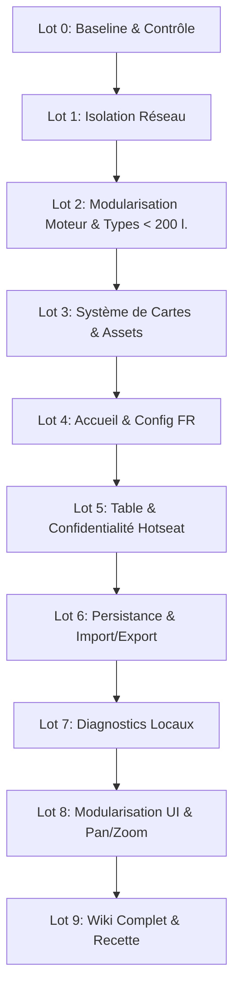

# Plan d'Implémentation Détaillé — Version Locale Autonome, Système de Cartes Illustrées & Modularisation Complète

Ce document opérationnel croise :
1. Les exigences d'autonomie et de jeu local sur un seul poste de [plan.md](file:///c:/Users/alano/OneDrive/Documents/GitHub/advanced-civilization/plan.md).
2. Les constats d'architecture et propositions ergonomiques de [code.md](file:///c:/Users/alano/OneDrive/Documents/GitHub/advanced-civilization/code.md).
3. L'intégration d'un **système de cartes illustrées** (produits, calamités, progrès de civilisation) servi depuis un dossier d'assets.
4. **La règle stricte de modularisation en fichiers de moins de 200 lignes**.
5. **La création systématique d'une documentation Wiki pour chaque fichier**, garantissant que le code soit limpide, détaillé et réexploitable par un tiers.

---

## Sommaire

1. [Vision, Principes et Périmètre](#1-vision-principes-et-périmètre)
2. [Charte de Modularité Stricte (< 200 Lignes) & Qualité du Code](#2-charte-de-modularité-stricte--200-lignes--qualité-du-code)
   - [2.1. Règle des 200 Lignes & Single Responsibility Principle](#21-règle-des-200-lignes--single-responsibility-principle)
   - [2.2. Plan de Décomposition des Fichiers Monolithiques](#22-plan-de-décomposition-des-fichiers-monolithiques)
   - [2.3. Script Automatisé de Contrôle des Tailles de Fichiers](#23-script-automatisé-de-contrôle-des-tailles-de-fichiers)
3. [Système de Documentation Wiki pour Chaque Fichier](#3-système-de-documentation-wiki-pour-chaque-fichier)
   - [3.1. Structure du Dossier Wiki (`docs/wiki/`)](#31-structure-du-dossier-wiki-docswiki)
   - [3.2. Gabarit Standardisé de Page Wiki (Template)](#32-gabarit-standardisé-de-page-wiki-template)
   - [3.3. Réexploitabilité et Normes de Documentation TSDoc / JSDoc](#33-réexploitabilité-et-normes-de-documentation-tsdoc--jsdoc)
4. [Spécification du Système d'Assets Graphiques (Cartes, Calamités, Progrès)](#4-spécification-du-système-dassets-graphiques-cartes-calamités-progrès)
   - [4.1. Arborescence des Assets et Formats](#41-arborescence-des-assets-et-formats)
   - [4.2. Table de Correspondance Exhaustive des Identifiants](#42-table-de-correspondance-exhaustive-des-identifiants)
   - [4.3. Composants React & Stratégie de Repli Émancipée (CSS Fallback)](#43-composants-react--stratégie-de-repli-émancipée-css-fallback)
5. [Architecture Logicielle Cible & Organisation Modulaire](#5-architecture-logicielle-cible--organisation-modulaire)
6. [Découpage Opérationnel en Lots](#6-découpage-opérationnel-en-lots)
   - [Lot 0 — Référence Technique et Mesure de Baseline](#lot-0--référence-technique-et-mesure-de-baseline)
   - [Lot 1 — Isolation Stricte des Services Externes](#lot-1--isolation-stricte-des-services-externes)
   - [Lot 2 — Modularisation des Types et du Cœur du Moteur (< 200 Lignes)](#lot-2--modularisation-des-types-et-du-cœur-du-moteur--200-lignes)
   - [Lot 3 — Système Visuel de Cartes & Composants d'Assets](#lot-3--système-visuel-de-cartes--composants-dassets)
   - [Lot 4 — Écran d'Accueil et Configuration Locale en Français](#lot-4--écran-daccueil-et-configuration-locale-en-français)
   - [Lot 5 — Table Locale, Confidentialité et Passage de Main (Hotseat)](#lot-5--table-locale-confidentialité-et-passage-de-main-hotseat)
   - [Lot 6 — Persistance Locale, Reprise et Import/Export](#lot-6--persistance-locale-reprise-et-importexport)
   - [Lot 7 — Diagnostics Locaux et Anonymisation](#lot-7--diagnostics-locaux-et-anonymisation)
   - [Lot 8 — Modularisation de l'Interface UI & Pan/Zoom Cartographique](#lot-8--modularisation-de-linterface-ui--panzoom-cartographique)
   - [Lot 9 — Documentation Wiki Exhaustive, Tests & Recette Joueurs](#lot-9--documentation-wiki-exhaustive-tests--recette-joueurs)
7. [Directives de Codage et Séquence de Commits](#7-directives-de-codage-et-séquence-de-commits)
8. [Critères de Sortie et Définition de « Terminé »](#8-critères-de-sortie-et-définition-de--terminé-)

---

## 1. Vision, Principes et Périmètre

### 1.1. Objectif Global
Développer une application **100 % autonome**, modulaire, exécutable sur un seul poste en local (hotseat entre humains et/ou contre des IA), sans dépendance réseau, dotée :
- d'une interface en **français**, ergonomique et lisible sur grand écran ;
- d'un mode de **confidentialité** (passage de main étanche) préservant le secret des cartes ;
- d'un système de **sauvegarde locale** fiable (autosave, export/import JSON) ;
- d'un système visuel de **cartes illustrées** pour les 18 marchandises, 12 calamités et 24 progrès ;
- d'une cartographie fluide avec **Pan & Zoom** interactif ;
- d'une base de code **intégralement découpée en fichiers de moins de 200 lignes**, accompagnée d'une **documentation wiki miroir** pour chaque fichier.

### 1.2. Principes Intangibles
1. **Intégrité absolue des règles** : Ne pas altérer la logique mathématique et l'équilibrage du jeu officiel Avalon Hill 1991.
2. **Découplage strict des états** :
   - *État moteur pur* : sérialisable, déterministe (`GameState`).
   - *Configuration de session* : contrôleurs, noms, options de confidentialité (`LocalSessionConfig`).
   - *État de présentation* : navigation, zoom, modales (`UIState`).
3. **Zéro régression** : La suite de tests existante (34+ tests Vitest) et le contrôle de types TypeScript doivent rester verts à tout moment.
4. **Résilience graphique** : Tout composant de carte doit être parfaitement rendu même en l'absence temporaire du fichier image correspondant (grâce au repli vectoriel/CSS).

---

## 2. Charte de Modularité Stricte (< 200 Lignes) & Qualité du Code

### 2.1. Règle des 200 Lignes & Single Responsibility Principle

Chaque fichier de code source (`.ts`, `.tsx`, `.mjs`) situé dans `src/` doit impérativement respecter les règles suivantes :
- **Ligne de code maximale** : **Strictement moins de 200 lignes** par fichier.
- **Principe de responsabilité unique (SRP)** : Un fichier = un composant React, un hook, un gestionnaire de phase, ou un ensemble cohérent de fonctions utilitaires pures.
- **Fichiers tonneaux / index (`index.ts`)** : Utilisés uniquement pour réexporter proprement les symboles publics sans logique métier, garantissant des imports clairs pour les modules consommateurs.

### 2.2. Plan de Décomposition des Fichiers Monolithiques

L'état initial du projet présente plusieurs fichiers monstres qui seront scindés :

```text
[Fichiers Monolithiques Actuels]               [Architecture Cible Modulaire (< 200 l.)]
├── src/engine/engine.ts (3 399 lignes)   ──>   src/engine/phases/* (1 phase = 1 fichier)
│                                                src/engine/combat/* (combats & assauts)
│                                                src/engine/calamities/* (résolution)
│                                                src/engine/core/* (adapter, normalisation)
├── src/ui/App.tsx (2 779 lignes)         ──>   src/ui/screens/* (écrans)
│                                                src/ui/components/board/* (carte & minimap)
│                                                src/ui/components/phases/* (contrôleurs)
│                                                src/ui/components/views/* (AST, Avances...)
├── src/engine/types.ts (775 lignes)      ──>   src/engine/types/* (state, actions, phases...)
└── src/ai/heuristic.ts (720 lignes)      ──>   src/ai/evaluators/* (trade, moves, cities...)
```

#### Décomposition détaillée de `src/engine/engine.ts` :
- `src/engine/phases/taxation.ts` (~80 lignes) : prélèvement fiscal et révoltes.
- `src/engine/phases/expansion.ts` (~110 lignes) : croissance de population et plafonds.
- `src/engine/phases/census.ts` (~60 lignes) : décompte et réordonnancement du tour.
- `src/engine/phases/ships.ts` (~120 lignes) : construction et entretien naval.
- `src/engine/phases/movement.ts` (~180 lignes) : validation des mouvements terrestres/maritimes.
- `src/engine/phases/combat.ts` (~190 lignes) : attrition ronde-robin et assauts de cités.
- `src/engine/phases/cities.ts` (~130 lignes) : érection de cités et vérification des sites.
- `src/engine/phases/surplus.ts` (~140 lignes) : élimination des surplus et soutien des cités.
- `src/engine/phases/trade.ts` (~190 lignes) : distribution des cartes, offres bilatérales.
- `src/engine/phases/calamity.ts` (~190 lignes) : déroulement et cascade des calamités.
- `src/engine/phases/advances.ts` (~160 lignes) : validation du panier d'achat et des réductions.
- `src/engine/phases/ast.ts` (~120 lignes) : avancement sur la frise chronologique et victoire.
- `src/engine/core/normalization.ts` (~160 lignes) : boucle d'avancement des phases automatiques.
- `src/engine/core/legality.ts` (~180 lignes) : calcul des actions légales selon la phase.
- `src/engine/core/CivAdapter.ts` (~140 lignes) : classe maîtresse implémentant `GameAdapter`.

#### Décomposition détaillée de `src/ui/App.tsx` :
- `src/ui/screens/GameScreen.tsx` (~150 lignes) : conteneur de jeu principal assemblant les composants.
- `src/ui/components/board/BoardView.tsx` (~170 lignes) : canevas vectoriel SVG et gestionnaire d'affichage.
- `src/ui/components/board/BoardTokens.tsx` (~160 lignes) : rendu des pions, bateaux, cités et barbares.
- `src/ui/components/board/Minimap.tsx` (~110 lignes) : mini-carte interactive.
- `src/ui/components/navigation/ControlBar.tsx` (~130 lignes) : barre inférieure et sélection de vue.
- `src/ui/components/navigation/StatusPanel.tsx` (~120 lignes) : panneau de ressources de la nation active.
- `src/ui/components/navigation/TurnTabs.tsx` (~90 lignes) : onglets d'ordre du tour.
- `src/ui/components/phases/MovementControls.tsx` (~180 lignes) : interface de planification de voyages.
- `src/ui/components/phases/TradeControls.tsx` (~190 lignes) : formulaire d'offres et d'acceptation de lots.
- `src/ui/components/phases/AdvancePicker.tsx` (~170 lignes) : sélection et achat d'avances.
- `src/ui/components/views/AstView.tsx` (~150 lignes) : visualisation de la frise chronologique.
- `src/ui/components/views/TechTreeView.tsx` (~180 lignes) : tableau/arbre des technologies.
- `src/ui/components/views/GoodsView.tsx` (~160 lignes) : inventaire des cartes et piles.
- `src/ui/components/views/CensusView.tsx` (~140 lignes) : tableau de démographie et scores.
- `src/ui/components/views/LogView.tsx` (~110 lignes) : journal narratif du tour.

### 2.3. Script Automatisé de Contrôle des Tailles de Fichiers

Pour garantir la pérennité de cette règle, un script Node.js de validation `scripts/check-line-counts.mjs` inspecte récursivement le répertoire `src/` :
- Si un fichier dépasse 200 lignes, le script affiche son chemin, son nombre de lignes et échoue avec un code d'erreur non nul (`exit 1`).
- Ce contrôle est branché dans `package.json` :
  ```json
  "scripts": {
    "check:lines": "node scripts/check-line-counts.mjs",
    "test": "vitest run && npm run check:lines"
  }
  ```

---

## 3. Système de Documentation Wiki pour Chaque Fichier

Afin de garantir que l'application soit entièrement **compréhensible, maintenable et réexploitable par un tiers**, une documentation miroir est mise en place dans le dossier `docs/wiki/`.

### 3.1. Structure du Dossier Wiki (`docs/wiki/`)

Chaque fichier de code source dispose de sa fiche descriptive dédiée :

```text
docs/wiki/
├── README.md                          # Table des matières globale et cartographie du projet
├── TEMPLATE.md                        # Modèle standardisé de fiche descriptive
│
├── engine/                            # Documentation du moteur
│   ├── CivAdapter.md
│   ├── normalization.md
│   ├── legality.md
│   ├── types/
│   │   ├── state.md
│   │   ├── actions.md
│   │   └── ...
│   └── phases/
│       ├── taxation.md
│       ├── movement.md
│       ├── combat.md
│       └── ...
│
├── ui/                                # Documentation de l'interface
│   ├── screens/
│   │   ├── HomeScreen.md
│   │   ├── LocalSetupScreen.md
│   │   └── GameScreen.md
│   ├── components/
│   │   ├── board/
│   │   ├── navigation/
│   │   └── views/
│   └── cards/
│       ├── CardFrame.md
│       ├── CommodityCard.md
│       ├── CalamityCard.md
│       └── AdvanceCard.md
│
├── local/                             # Documentation de la couche locale autonome
│   ├── session.md
│   ├── persistence.md
│   └── diagnostics.md
│
└── ai/                                # Documentation de l'intelligence artificielle
    ├── heuristic.md
    └── evaluators.md
```

---

### 3.2. Gabarit Standardisé de Page Wiki (Template)

Chaque fichier documenté suit scrupuleusement la structure ci-dessous ([docs/wiki/TEMPLATE.md](file:///c:/Users/alano/OneDrive/Documents/GitHub/advanced-civilization/docs/wiki/TEMPLATE.md)) :

````markdown
# Fiche Wiki : [NomDuComposantOuModule]

## 1. Fiche d'Identité
- **Fichier source** : `src/chemin/vers/fichier.ts`
- **Rôle principal** : Résumé en 1 ou 2 phrases de la responsabilité unique du fichier.
- **Domaine** : [Moteur / UI / Données / IA / Persistance]
- **Taille** : [Nombre de lignes] (< 200 lignes)

## 2. Architecture & Dépendances
- **Imports clés** :
  - `dep-1` : rôle de l'import.
- **Exports publics** :
  - `FonctionA` / `ComposantB` / `InterfaceC`.
- **Modules dépendants** : Qui appelle ce fichier ?

## 3. Spécification de l'API Publique
### Types & Interfaces
```typescript
export interface MonInterfaceProps {
  // Description des champs
}
```
### Fonctions / Composants
#### `maFonction(param1, param2)`
- **Paramètres** : description détaillée.
- **Retour** : valeur et type retourné.
- **Exceptions** : cas de rejet ou de retour d'erreur.

## 4. Logique Interne & Règles Métier
- Description de l'algorithme sous-jacent.
- Référence aux règles officielles d'Advanced Civilization (§ article de règle).
- Décisions de conception et gestion des cas limites (*edge cases*).

## 5. Exemple d'Utilisation
```typescript
import { maFonction } from './chemin';

const resultat = maFonction(arg1, arg2);
```

## 6. Guide de Maintenance & Réexploitabilité
- Comment étendre ou modifier ce module sans risque ?
- Tests associés : `src/chemin/vers/fichier.test.ts`.
- Points de vigilance particuliers.
````

---

### 3.3. Réexploitabilité et Normes de Documentation TSDoc / JSDoc

En complément du Wiki, le code lui-même doit comporter des commentaires TSDoc complets :
- Chaque interface, type, propriété et méthode publique est annoté (`@param`, `@returns`, `@throws`, `@example`).
- Aucune abréviation obscure dans les noms de variables.
- Constantes nommées pour éviter tout chiffre magique.

---

## 4. Spécification du Système d'Assets Graphiques (Cartes, Calamités, Progrès)

### 4.1. Arborescence des Assets et Formats

Les images générées seront stockées dans `public/assets/cards/` (servies directement par Vite) :

```text
public/
  assets/
    cards/
      commodities/    # Les 18 cartes de marchandises (Ochre, Hides, ..., Gold, Ivory)
        ochre.webp
        hides.webp
        ...
      calamities/      # Les 12 cartes de calamités (Volcano, Epidemic, Piracy, ...)
        volcano.webp
        epidemic.webp
        ...
      advances/        # Les 24 cartes de progrès / technologies
        pottery.webp
        astronomy.webp
        ...
      back/            # Dos des cartes
        commodity-back.webp
        calamity-back.webp
        advance-back.webp
```

Dimensions recommandées : **ratio 2:3** (ex: 300 × 450 px ou 400 × 600 px).

---

### 4.2. Table de Correspondance Exhaustive des Identifiants

Les noms des fichiers images doivent correspondre **strictement** aux `id` déclarés dans les fichiers JSON du moteur :

#### Marchandises (18 produits réparties en 9 piles — [commodities.json](file:///c:/Users/alano/OneDrive/Documents/GitHub/advanced-civilization/src/data/commodities.json))

| Pile (Stack) | ID Fichier Image | Nom Français | Nom Anglais | Valeur Unitaire | Formule de Série |
|---|---|---|---|---|---|
| **1** | `ochre.webp` | Ocre | Ochre | 1 | $1 \times n^2$ (max 7) |
| **1** | `hides.webp` | Peaux | Hides | 1 | $1 \times n^2$ (max 7) |
| **2** | `iron.webp` | Fer | Iron | 2 | $2 \times n^2$ (max 8) |
| **2** | `papyrus.webp` | Papyrus | Papyrus | 2 | $2 \times n^2$ (max 7) |
| **3** | `salt.webp` | Sel | Salt | 3 | $3 \times n^2$ (max 9) |
| **3** | `timber.webp` | Bois | Timber | 3 | $3 \times n^2$ (max 8) |
| **4** | `grain.webp` | Céréales | Grain | 4 | $4 \times n^2$ (max 8) |
| **4** | `oil.webp` | Huile | Oil | 4 | $4 \times n^2$ (max 7) |
| **5** | `cloth.webp` | Tissu | Cloth | 5 | $5 \times n^2$ (max 7) |
| **5** | `wine.webp` | Vin | Wine | 5 | $5 \times n^2$ (max 6) |
| **6** | `bronze.webp` | Bronze | Bronze | 6 | $6 \times n^2$ (max 6) |
| **6** | `silver.webp` | Argent | Silver | 6 | $6 \times n^2$ (max 5) |
| **7** | `resin.webp` | Résine | Resin | 7 | $7 \times n^2$ (max 5) |
| **7** | `spices.webp` | Épices | Spices | 7 | $7 \times n^2$ (max 6) |
| **8** | `dye.webp` | Teinture | Dye | 8 | $8 \times n^2$ (max 4) |
| **8** | `gems.webp` | Pierres précieuses | Gems | 8 | $8 \times n^2$ (max 5) |
| **9** | `gold.webp` | Or | Gold | 9 | $9 \times n^2$ (max 5) |
| **9** | `ivory.webp` | Ivoire | Ivory | 9 | $9 \times n^2$ (max 4) |

#### Calamités (12 calamités — [calamities.json](file:///c:/Users/alano/OneDrive/Documents/GitHub/advanced-civilization/src/data/calamities.json))

| ID Fichier Image | Nom Français | Nom Anglais | Pile | Négociable ? | Gravité |
|---|---|---|---|---|---|
| `volcano.webp` | Éruption Volcanique / Séisme | Volcanic Eruption / Earthquake | 2 | ❌ Non | 1 |
| `treachery.webp` | Trahison | Treachery | 2 | ✅ Oui | 2 |
| `famine.webp` | Famine | Famine | 3 | ❌ Non | 3 |
| `superstition.webp` | Superstition | Superstition | 3 | ✅ Oui | 4 |
| `civilwar.webp` | Guerre Civile | Civil War | 4 | ❌ Non | 5 |
| `slaverevolt.webp` | Révolte d'Esclaves | Slave Revolt | 4 | ✅ Oui | 6 |
| `flood.webp` | Inondation | Flood | 5 | ❌ Non | 7 |
| `barbarianhordes.webp` | Hordes Barbares | Barbarian Hordes | 5 | ✅ Oui | 8 |
| `epidemic.webp` | Épidémie | Epidemic | 6 | ✅ Oui | 9 |
| `civildisorder.webp` | Désordre Civil | Civil Disorder | 7 | ✅ Oui | 10 |
| `iconoclasm.webp` | Iconoclasme & Hérésie | Iconoclasm & Heresy | 8 | ✅ Oui | 11 |
| `piracy.webp` | Piraterie | Piracy | 9 | ✅ Oui | 12 |

#### Avances de Civilisation (24 progrès — [advances.json](file:///c:/Users/alano/OneDrive/Documents/GitHub/advanced-civilization/src/data/advances.json))

| ID Fichier Image | Nom Français | Nom Anglais | Domaine / Groupe | Coût | Prérequis |
|---|---|---|---|---|---|
| `pottery.webp` | Poterie | Pottery | Métiers (Crafts) | 45 | Aucun |
| `clothmaking.webp` | Tissage | Cloth Making | Métiers (Crafts) | 45 | Aucun |
| `metalworking.webp` | Métallurgie | Metalworking | Métiers (Crafts) | 80 | Aucun |
| `agriculture.webp` | Agriculture | Agriculture | Métiers (Crafts) | 110 | Aucun |
| `engineering.webp` | Ingénierie | Engineering | Métiers / Sciences | 140 | Aucun |
| `roadbuilding.webp` | Construction de Routes | Roadbuilding | Métiers (Crafts) | 140 | Ingénierie |
| `mining.webp` | Exploitation Minière | Mining | Métiers (Crafts) | 180 | Ingénierie |
| `astronomy.webp` | Astronomie | Astronomy | Sciences | 80 | Aucun |
| `coinage.webp` | Monnayage | Coinage | Sciences | 110 | Aucun |
| `medicine.webp` | Médecine | Medicine | Sciences | 140 | Aucun |
| `mathematics.webp` | Mathématiques | Mathematics | Sciences / Arts | 230 | Aucun |
| `drama.webp` | Théâtre et Poésie | Drama and Poetry | Arts | 60 | Aucun |
| `music.webp` | Musique | Music | Arts | 60 | Aucun |
| `architecture.webp` | Architecture | Architecture | Arts | 120 | Aucun |
| `literacy.webp` | Écriture | Literacy | Arts / Civisme | 110 | Aucun |
| `law.webp` | Droit | Law | Civisme (Civics) | 170 | Aucun |
| `democracy.webp` | Démocratie | Democracy | Civisme (Civics) | 200 | Droit |
| `military.webp` | Armée Permanente | Military | Civisme (Civics) | 180 | Aucun |
| `philosophy.webp` | Philosophie | Philosophy | Civisme (Civics) | 240 | Droit |
| `mysticism.webp` | Mysticisme | Mysticism | Religion / Arts | 50 | Aucun |
| `deism.webp` | Déisme | Deism | Religion | 80 | Aucun |
| `enlightenment.webp` | Éveil Spirituel | Enlightenment | Religion | 150 | Aucun |
| `monotheism.webp` | Monothéisme | Monotheism | Religion | 220 | Éveil Spirituel |
| `theology.webp` | Théologie | Theology | Religion | 250 | Éveil Spirituel |

---

### 4.3. Composants React & Stratégie de Repli Émancipée (CSS Fallback)

Le composant modulaire `CardFrame.tsx` (< 120 lignes) vérifie si l'image est disponible :
- En cas de succès : affiche l'image avec son encadrement or antique, badge de valeur et cartouche de titre.
- En cas d'échec ou d'absence : bascule sans à-coup sur une composition vectorielle CSS avec fond dégradé texturé, symbole stylisé de domaine, titre et caractéristiques chiffrées.

---

## 5. Architecture Logicielle Cible & Organisation Modulaire

```text
src/
├── config/
│   └── features.ts              # Feature flags centraux (< 30 l.)
│
├── local/                       # Gestion autonome locale (< 150 l. / fichier)
│   ├── types.ts
│   ├── session.ts
│   ├── persistence.ts
│   ├── save-format.ts
│   └── diagnostics.ts
│
├── engine/                      # Moteur scindé en modules < 200 l.
│   ├── index.ts
│   ├── core/
│   │   ├── CivAdapter.ts
│   │   ├── normalization.ts
│   │   └── legality.ts
│   ├── types/
│   │   ├── index.ts
│   │   ├── state.ts
│   │   ├── actions.ts
│   │   ├── phases.ts
│   │   └── trade.ts
│   └── phases/
│       ├── taxation.ts
│       ├── expansion.ts
│       ├── movement.ts
│       ├── combat.ts
│       ├── cities.ts
│       ├── surplus.ts
│       ├── trade.ts
│       ├── calamity.ts
│       ├── advances.ts
│       └── ast.ts
│
├── ai/                          # IA heuristique scindée en modules < 180 l.
│   ├── heuristic.ts
│   └── evaluators/
│       ├── movePlanner.ts
│       ├── cityPlanner.ts
│       ├── tradePlanner.ts
│       └── advancePlanner.ts
│
└── ui/                          # Interface utilisateur scindée en composants < 180 l.
    ├── screens/
    │   ├── HomeScreen.tsx
    │   ├── LocalSetupScreen.tsx
    │   └── GameScreen.tsx
    ├── cards/
    │   ├── CardFrame.tsx
    │   ├── CommodityCard.tsx
    │   ├── CalamityCard.tsx
    │   └── AdvanceCard.tsx
    ├── components/
    │   ├── board/
    │   │   ├── BoardView.tsx
    │   │   ├── BoardTokens.tsx
    │   │   └── Minimap.tsx
    │   ├── navigation/
    │   │   ├── ControlBar.tsx
    │   │   ├── StatusPanel.tsx
    │   │   ├── TurnTabs.tsx
    │   │   └── PlayerHandoffModal.tsx
    │   ├── phases/
    │   │   ├── MovementControls.tsx
    │   │   ├── TradeControls.tsx
    │   │   └── AdvancePicker.tsx
    │   └── views/
    │       ├── AstView.tsx
    │       ├── TechTreeView.tsx
    │       ├── GoodsView.tsx
    │       ├── CensusView.tsx
    │       └── LogView.tsx
    └── main.tsx
```

---

## 6. Découpage Opérationnel en Lots



---

### Lot 0 — Référence Technique et Mesure de Baseline

**Objectif** : Établir l'état de référence exact avant tout codage et mettre en place le script de vérification des lignes.

- **Actions** :
  1. Créer la branche : `git checkout -b feat/local-standalone`.
  2. Écrire le script [scripts/check-line-counts.mjs](file:///c:/Users/alano/OneDrive/Documents/GitHub/advanced-civilization/scripts/check-line-counts.mjs) qui analyse les fichiers de `src/` et liste les fichiers actuels dépassant 200 lignes pour suivre leur résorption.
  3. Exécuter les commandes de référence :
     ```powershell
     npm run typecheck
     npm test
     npm run build:ui
     ```
  4. Créer la structure `docs/wiki/` et le fichier [docs/wiki/TEMPLATE.md](file:///c:/Users/alano/OneDrive/Documents/GitHub/advanced-civilization/docs/wiki/TEMPLATE.md).
- **Critère de sortie** : État initial mesuré et consigné ; `TEMPLATE.md` en place.

---

### Lot 1 — Isolation Stricte des Services Externes

**Objectif** : Empêcher tout appel réseau et neutraliser les dépendances distantes dans le parcours local.

- **Actions** :
  1. Créer [src/config/features.ts](file:///c:/Users/alano/OneDrive/Documents/GitHub/advanced-civilization/src/config/features.ts) (< 30 lignes).
  2. Créer sa fiche wiki : `docs/wiki/config/features.md`.
  3. Dans [src/ui/main.tsx](file:///c:/Users/alano/OneDrive/Documents/GitHub/advanced-civilization/src/ui/main.tsx), neutraliser les appels distants (`fetchUnseenResponses`, `recordPlay`, `recordFinish`, télémétrie `ErrorBoundary`).
  4. Bloquer le lobby en ligne avec un message explicatif en français.
- **Critère de sortie** : 0 requête réseau émise dans le navigateur lors du lancement.

---

### Lot 2 — Modularisation des Types et du Cœur du Moteur (< 200 Lignes)

**Objectif** : Décomposer `types.ts` (775 l.) et `engine.ts` (3 399 l.) en modules autonomes de moins de 200 lignes avec documentation wiki associée, sans casser aucun des 34 tests existants.

- **Actions** :
  1. Scinder `src/engine/types.ts` en sous-modules dans `src/engine/types/` (`state.ts`, `actions.ts`, `phases.ts`, `trade.ts`). Re-exporter depuis `types/index.ts`.
  2. Scinder `src/engine/engine.ts` :
     - Extraire chaque phase dans `src/engine/phases/[nomPhase].ts`.
     - Extraire `normalization.ts` et `legality.ts` dans `src/engine/core/`.
     - Réduire `CivAdapter.ts` à la classe d'orchestration (< 150 lignes).
  3. Rédiger les fiches wiki correspondantes dans `docs/wiki/engine/`.
  4. Valider l'intégrité par les tests Vitest à chaque étape d'extraction.
- **Critère de sortie** : Tous les fichiers sous `src/engine/` font strictement moins de 200 lignes. Les tests Vitest passent à 100 %.

---

### Lot 3 — Système Visuel de Cartes & Composants d'Assets

**Objectif** : Mettre en place les composants React de cartes illustrées avec fallback CSS et documentation wiki.

- **Actions** :
  1. Créer `public/assets/cards/` (`commodities/`, `calamities/`, `advances/`, `back/`).
  2. Créer `src/ui/cards/CardFrame.tsx` (< 120 lignes) avec détection d'image et fallback stylisé.
  3. Créer `src/ui/cards/CommodityCard.tsx`, `CalamityCard.tsx`, `AdvanceCard.tsx` (< 150 lignes chacun).
  4. Rédiger les fiches wiki dans `docs/wiki/ui/cards/`.
  5. Écrire des tests unitaires de rendu : `src/ui/cards/cards.test.tsx`.
- **Critère de sortie** : Les cartes s'affichent avec élégance avec ou sans image. Fichiers < 200 lignes et documentés dans le wiki.

---

### Lot 4 — Écran d'Accueil et Configuration Locale en Français

**Objectif** : Proposer une interface d'accueil et de sélection de partie soignée, en français et modulaire.

- **Actions** :
  1. Créer `src/ui/screens/HomeScreen.tsx` (< 150 lignes).
  2. Créer `src/ui/screens/LocalSetupScreen.tsx` (< 190 lignes) avec sélection des civilisations, attribution humain/IA et choix du plateau.
  3. Rédiger les fiches wiki dans `docs/wiki/ui/screens/`.
- **Critère de sortie** : Accueil direct en français, configuration intuitive, 0 dépendance distante.

---

### Lot 5 — Table Locale, Confidentialité et Passage de Main (Hotseat)

**Objectif** : Préserver le secret des mains privées entre plusieurs joueurs sur le même écran.

- **Actions** :
  1. Créer `src/ui/components/navigation/PlayerHandoffModal.tsx` (< 120 lignes) : rideau de masquage opaque avant le tour de chaque joueur humain.
  2. Ajouter les commutateurs de confidentialité dans la barre de contrôle.
  3. Rédiger la fiche wiki associée.
- **Critère de sortie** : Aucune carte privée n'est dévoilée involontairement lors des changements de tour entre humains.

---

### Lot 6 — Persistance Locale, Reprise et Import/Export

**Objectif** : Sauvegarder automatiquement chaque tour et permettre le partage de sauvegardes au format JSON.

- **Actions** :
  1. Créer `src/local/persistence.ts` (< 160 lignes) et `src/local/save-format.ts` (< 140 lignes).
  2. Implémenter l'exportation et l'importation validée de fichiers `advciv-save-*.json`.
  3. Rédiger les fiches wiki dans `docs/wiki/local/`.
  4. Créer des tests unitaires de persistance : `src/local/persistence.test.ts`.
- **Critère de sortie** : Reprise instantanée après rechargement, import/export validé et protégé contre les fichiers corrompus.

---

### Lot 7 — Diagnostics Locaux et Anonymisation

**Objectif** : Exporter les diagnostics techniques localement sans aucune télémétrie distante.

- **Actions** :
  1. Créer `src/local/diagnostics.ts` (< 140 lignes) et `src/ui/components/modals/LocalDiagnosticModal.tsx` (< 150 lignes).
  2. Permettre le téléchargement d'un rapport technique anonymisé en local.
  3. Rédiger les fiches wiki correspondantes.
- **Critère de sortie** : Rapport de diagnostic local généré en 1 clic.

---

### Lot 8 — Modularisation de l'Interface UI & Pan/Zoom Cartographique

**Objectif** : Achever la décomposition de `App.tsx` (< 200 lignes pour chaque composant extrait) et intégrer la navigation fluide à la souris.

- **Actions** :
  1. Extraire les composants de plateau dans `src/ui/components/board/` (`BoardView.tsx`, `BoardTokens.tsx`, `Minimap.tsx`).
  2. Implémenter le glisser-déplacer (*Click & Drag*) et le zoom continu à la molette (*Wheel Zoom*).
  3. Extraire les vues dans `src/ui/components/views/` (`AstView.tsx`, `TechTreeView.tsx`, `GoodsView.tsx`, `CensusView.tsx`, `LogView.tsx`) et intégrer les cartes visuelles.
  4. Extraire les contrôles de phases dans `src/ui/components/phases/` (`MovementControls.tsx`, `TradeControls.tsx`, `AdvancePicker.tsx`).
  5. Réduire `GameScreen.tsx` / `App.tsx` sous la barre des 180 lignes.
  6. Rédiger l'ensemble des fiches wiki correspondantes dans `docs/wiki/ui/`.
- **Critère de sortie** : Plus aucun fichier au-dessus de 200 lignes dans tout le projet UI. Navigation cartographique ultra-fluide.

---

### Lot 9 — Documentation Wiki Exhaustive, Tests & Recette Joueurs

**Objectif** : Finaliser le Wiki, exécuter le script de validation des 200 lignes et valider la recette complète.

- **Actions** :
  1. Compléter le sommaire général `docs/wiki/README.md` reliant toutes les fiches.
  2. Exécuter le vérificateur de lignes :
     ```powershell
     npm run check:lines
     ```
     (Résultat attendu : 100 % des fichiers < 200 lignes).
  3. Exécuter l'intégralité des tests :
     ```powershell
     npm run typecheck
     npm test
     npm run build:ui
     ```
  4. Réaliser la recette fonctionnelle (parties solo et hotseat 2 joueurs).
  5. Rédiger le guide de test pour les joueurs dans `docs/GUIDE_TESTEUR.md`.
- **Critère de sortie** : 0 fichier >= 200 lignes, 100 % des tests verts, wiki complet et partie jouable clé en main.

---

## 7. Directives de Codage et Séquence de Commits

### 7.1. Règles pour les Développeurs
- **Règle absolue des 200 lignes** : Aucun fichier source ne doit dépasser 200 lignes.
- **Une fiche Wiki par fichier** : Chaque nouveau fichier ou refactorisation majeure est systématiquement accompagnée de sa fiche dans `docs/wiki/`.
- **Typage strict** : Aucun `any`, interfaces explicites.
- **Nommage clair** : Fonctions et variables auto-documentées en anglais pour le code technique, textes d'interface en français pour l'utilisateur.

### 7.2. Séquence de Commits Recommandée
```text
1. test(baseline): establish baseline, template wiki and line checker script
2. refactor(config): isolate external services and add features flag + wiki
3. refactor(engine-types): modularize engine types under 200 lines + wiki
4. refactor(engine-phases): split engine.ts into individual phase modules + wiki
5. feat(cards): create CardFrame and card asset components with CSS fallback + wiki
6. feat(screens): add French HomeScreen and LocalSetupScreen + wiki
7. feat(hotseat): add privacy mode and player handoff modal + wiki
8. feat(persistence): implement local save, auto-save and import/export + wiki
9. feat(diagnostics): add offline local diagnostic export + wiki
10. refactor(board): enhance map navigation with smooth pan & zoom + modularize board
11. refactor(views): modularize UI views under 200 lines and integrate card assets
12. docs(wiki): finalize full wiki documentation index and tester guide
```

---

## 8. Critères de Sortie et Définition de « Terminé »

Le chantier sera déclaré **terminé et livré avec succès** lorsque les conditions suivantes seront réunies :

- [x] **Modularité totale** : Aucun fichier source dans `src/` ne dépasse 200 lignes (validé par `npm run check:lines`).
- [x] **Documentation Wiki miroir** : Chaque fichier du projet dispose de sa fiche détaillée dans `docs/wiki/` selon le gabarit `TEMPLATE.md`.
- [x] **Autonomie locale** : L'application démarre sans écran de connexion, en français, et ne produit aucune requête réseau sortante.
- [x] **Système de cartes illustrées** : Les cartes de produits, calamités et progrès sont intégrées, avec repli automatique CSS si une image est absente.
- [x] **Confidentialité hotseat** : Le rideau de passage de main protège les cartes secrètes lors d'une partie multi-humains sur le même poste.
- [x] **Sauvegarde & Reprise** : Persistance automatique locale après chaque action, avec export et import de fichiers JSON.
- [x] **Cartographie moderne** : Déplacement libre (*Drag*) et zoom molette (*Wheel Zoom*) sur le plateau de jeu.
- [x] **Qualité irréprochable** : `npm run typecheck`, `npm test` et `npm run build:ui` s'exécutent avec 100 % de succès.
